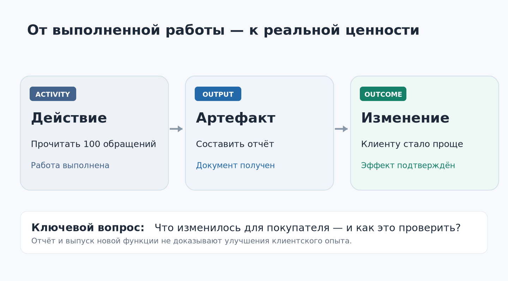
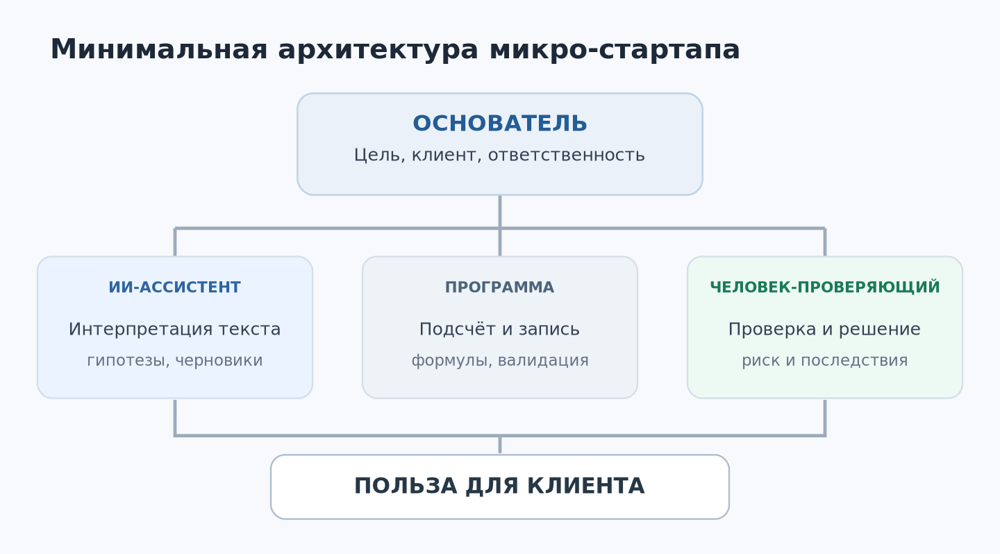
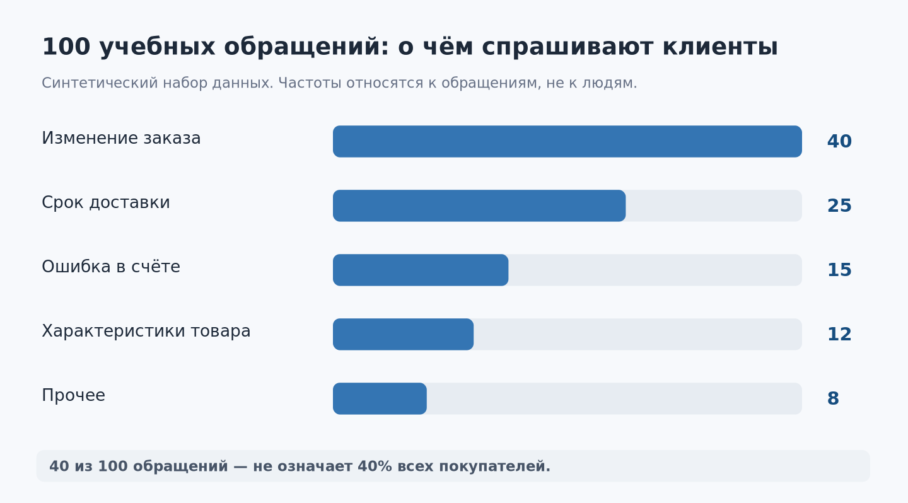

# Урок 01. Компания из одного человека и команды ИИ

**Курс:** AI-Native Startup — от проблемы клиента до работающего сервиса  
**Неделя:** 1 · **Занятие:** 1 из 12  
**Версия:** 1.0 · **Дата редакции:** 14 октября 2026 года  
**Время занятия:** 100 минут · **Самостоятельная работа:** 30–45 минут  
**Для кого:** будущие основатели небольших IT-стартапов, специалисты и студенты, уверенно пользующиеся компьютером  
**Не требуется:** опыт программирования или платная подписка на конкретный ИИ-сервис

> **Главный вопрос урока:** не «Сколько работы может выполнить искусственный интеллект?», а «Какой полезный результат мы хотим получить для клиента — и какой самый короткий надёжный путь к нему?»

## Чему вы научитесь

После урока вы сможете: отличать действие, сделанный артефакт и изменение для клиента; объяснять, что такое AI-native организация; представить бизнес как рабочий поток (*workflow*); выбирать, что оставить человеку, поручить ИИ или автоматизировать обычным кодом; определить проверяемый результат; оформить исходную гипотезу своего стартапа в три рабочих файла.

На протяжении шести недель у каждого участника будет один **сквозной проект**. На первом занятии мы ещё ничего не запускаем на рынок и не подключаем настоящие клиентские переписки. Мы учимся правильно определять работу, которую вообще стоит выполнять.

---

## 1. Знакомая ситуация: «Мы очень заняты, но что изменилось?»

Вообразите маленькую команду. Ирина хорошо понимает рынок: много общается с клиентами, замечает, что им неудобно пользоваться существующими сервисами. Максим умеет проектировать программы. Вместе они решили открыть IT-стартап.

В первый понедельник они распределили задачи. Максим создаёт сайт, логотип и аккаунты в соцсетях. Ирина анализирует конкурентов, пишет длинный бизнес-план, составляет таблицу из пятидесяти будущих функций. На помощь им приходят ИИ-ассистенты: за пару дней готовы сотни строк кода, рекламные тексты, десятки картинок, презентация для инвестора.

В пятницу команда с удовлетворением подводит итог. Сделано очень много.

Но попробуйте задать один вопрос:

**Какую конкретную проблему клиента они теперь решают лучше, чем в понедельник?**

Возможно, никакую. Ни с одним потенциальным покупателем ещё не поговорили. Никто не проверил, за что люди готовы платить. В этом заключается ловушка современной ИИ-разработки: производство артефактов стало дешевле, а проверка необходимости этих артефактов всё ещё требует внимания и контакта с реальностью.

Илья Красинский в исходной лекции неоднократно показывает похожие ситуации. Его тезис: количество функций, документов, совещаний и завершённых задач не следует путать с бизнес-результатом. Особенно легко совершить эту ошибку, когда ИИ способен быстро произвести много убедительно выглядящих материалов.



### Три разных уровня работы

Предположим, основатель говорит: «За неделю мы проанализировали сто обращений в поддержку». Разложим это утверждение.

| Уровень | Что произошло | Как можно проверить |
|---|---|---|
| **Activity** — деятельность | Сотрудник или агент прочитал и классифицировал обращения | Есть журнал выполнения анализа |
| **Output** — продукт работы | Получен отчёт с пятью типовыми проблемами | Файл существует, данные и классификация проверены |
| **Outcome** — полезное изменение | Устранена ошибка заказа; покупатели реже нуждаются в помощи, не теряя возможности купить | Метрики и реальные клиентские сценарии после изменения подтверждают эффект |

Первые два уровня находятся почти полностью под нашим контролем. С третьим сложнее. Действительно ли исправление облегчило жизнь покупателя? Не привело ли оно к другой ошибке? Может быть, люди перестали писать в поддержку потому, что теперь вообще не могут закончить покупку?

**Результат нельзя объявить достигнутым только потому, что ИИ сообщил «готово».**

Именно поэтому в нашем курсе каждый практический проект будет развиваться по цепочке:

**Гипотеза → действие → артефакт → проверка → изменение для клиента → новое решение.**

> **Запомните:** сделанный продукт — необходимое достижение, но ещё не доказательство его полезности.

### Маленькое упражнение

Подумайте, что из следующего является «output», а что — «outcome»:

1. Агент написал двадцать рекламных объявлений.
2. После эксперимента стало больше квалифицированных заявок при сопоставимых расходах.
3. Программист исправил ошибку в форме оплаты.
4. Доля покупателей, успешно завершивших оплату, выросла, а число связанных жалоб не увеличилось.

**Ответы:** 1 и 3 — *output*; 2 и 4 — признаки *outcome*, если измерения корректны и изменения можно обоснованно связать с вмешательством. Утверждать причинность только по факту роста показателя нельзя.

---

## 2. Что означает «компания, построенная вокруг ИИ»

Термин *AI-native* не означает, что в компании нет людей. Он означает, что при проектировании работы мы **сразу учитываем возможности и ограничения ИИ**, вместо того чтобы добавить чат-бота сбоку к старым процедурам.

В обычной организации задача может проходить через несколько отделов: менеджер пишет техническое задание, дизайнер рисует макет, разработчик создаёт программу, аналитик объясняет показатели, редактор пишет сообщение клиенту.

В микро-стартапе из одного-двух человек такого штата просто нет. Основатель вынужден совмещать роли. Теперь часть рутинных и исследовательских операций может выполнять программная система, использующая ИИ.

Но у человека остаются особенно важные обязанности:

- выбрать реальную проблему, достойную решения;
- установить цели и ограничения;
- законно получить необходимые данные и разрешения;
- проверять предложения ИИ и принимать решения с последствиями для клиентов;
- разговаривать с покупателями и узнавать, что происходит за пределами интерфейса;
- отвечать за качество, безопасность и финансовые обязательства.

Таким образом, основатель становится не «магом, который знает правильный промпт», а **архитектором рабочей системы**.

### Где заканчивается чат-бот и начинается агент

Чат-бот отвечает на вопросы и создаёт текст. Он уже может быть полезным. Однако агентная система дополнительно использует инструменты и выполняет некоторую последовательность действий для достижения цели.

Пример без агента:

> «Вот десять обращений клиентов. Раздели их по темам и сделай таблицу».

Пример агентной работы:

> «Прочитай разрешённый файл обращений, проверь, что в нём нет персональных данных, сгруппируй причины, запиши таблицу в `report.csv`, затем сравни итоговые суммы с исходным количеством строк и выведи список неопределённых случаев».

Во втором случае речь идёт не просто о рассуждении. Система должна иметь **доступ к файлам и соответствующие инструменты**. Если таких инструментов нет, она сможет только предложить инструкцию или текст результата, а не реально записать файл.

Современные агентные среды различаются интерфейсом и набором подключений; для первого урока нам достаточно понять три элемента:

1. **Модель** — интерпретирует текст и предлагает следующее действие.
2. **Инструмент** — выполняет конкретную операцию: читает файл, вызывает API, производит вычисление.
3. **Правила и проверки** — определяют допустимые действия, ограничения и способ контроля результата.



На следующих занятиях мы познакомимся с *Skills*, памятью, агентными инструкциями, *hooks*, проектными стандартами и более сложной оркестрацией. Пока важно другое: **наличие десяти агентов не доказывает, что они нужны**.

### Пример: маленькая услуга на базе ИИ

Представим сервис для предпринимателей: раз в неделю он анализирует клиентские обращения и помогает выявлять проблемы.

На старте вполне достаточно:

- **Основатель** получает данные законным способом, уточняет задачу у клиента, проверяет критические выводы и согласует рекомендации.
- **ИИ-ассистент** классифицирует обезличенные обращения, готовит гипотезы и черновик отчёта.
- **Обычная программа или таблица** считает суммы, проверяет обязательные поля, сохраняет историю измерений.

Сложный «отдел ИИ-исследований» здесь не нужен. Сначала требуется доказать, что такая услуга кому-то помогает и что её экономически возможно предоставлять.

---

## 3. Бизнес — это путь клиента, а не список функций

Почему клиенты покупают продукт? Обычно не из-за числа кнопок, экранов или модных технологий. Им нужно перейти из одной ситуации в другую.

Например, владелец магазина может хотеть, чтобы его покупатели меньше терялись при оформлении заказа, а менеджерам не приходилось каждый день отвечать на одинаковые вопросы.

Мы будем описывать это в духе *Jobs To Be Done* (JTBD): **когда возникает ситуация X, человеку нужно добиться Y, потому что это поможет ему получить Z**.

Для нашего примера:

> Когда в интернет-магазине растёт число однотипных обращений, руководитель хочет понять реальные причины затруднений покупателей, чтобы устранить наиболее существенные проблемы и не расширять службу поддержки без необходимости.

Это ещё не подтверждённое знание о потребностях рынка. Это формулировка **клиентской гипотезы**, которую предстоит проверить интервью и пилотами.

### Что такое workflow

*Workflow* — последовательность шагов от исходного события к результату. Важно видеть не только работу нашей программы, но и то, что происходит до и после неё.

В нашем примере:

1. Клиент магазина сталкивается с затруднением.
2. Обращается в поддержку — или молча отказывается от покупки.
3. Магазин фиксирует обращение.
4. Наш сервис анализирует обезличенный набор таких обращений.
5. Руководитель изучает выводы и подтверждает проблему дополнительными данными.
6. Команда магазина проверяет исправление.
7. Изменение отражается или не отражается в поведении покупателей.

Заметьте: **отчёт стоит лишь посередине цепочки**. Хороший отчёт может ничего не изменить, если никто им не воспользуется.

Красинский показывает именно такое различие на примере клиентских звонков. В его рассказе покупатель хотел изменить несколько позиций в счёте, но не смог или не понял, как сделать это самостоятельно. Вместо вопроса «как быстрее ответить на звонок?» возникает другой: «почему человеку вообще пришлось звонить?» История служит иллюстрацией метода; в учебном наборе ниже приведены **отдельно придуманные данные**, а не исходная выгрузка его клиента.

### Отличие причины от симптома

Если посетитель не может закончить оплату, система поддержки может отреагировать быстрее. Но это не обязательно устранит причину.

Возможны разные гипотезы:

- пользователь не видит кнопку подтверждения;
- форма отбрасывает корректные данные;
- платёжный провайдер возвращает ошибку;
- человек не понимает условия оплаты;
- его банк отклоняет операцию.

Для каждой гипотезы нужны свои данные и своя проверка. Чем раньше мы научимся не выдавать догадку за факт, тем меньше бессмысленной работы будем выполнять.

---

## 4. Практический кейс: сто обращений в поддержку

Перед нами **синтетический** набор из 100 учебных обращений, придуманный специально для курса. В нём нет сведений о реальных покупателях, а распределение причин выбрано авторами урока.



| Категория | Число обращений |
|---|---:|
| Нельзя или непонятно как изменить заказ | 40 |
| Неизвестен срок доставки | 25 |
| Ошибка в счёте | 15 |
| Вопрос о характеристиках товара | 12 |
| Прочее | 8 |
| **Всего** | **100** |

Файл `data/obrashcheniya_100_bez_metok.csv` входит в учебный комплект: в нём 100 текстов обращений без учебных категорий. Версия с категориями (`data/obrashcheniya_100.csv`) находится в материалах преподавателя и служит контрольной разметкой.

### Что можно утверждать по таблице

Мы действительно видим, что в этом **учебном наборе** наиболее многочисленная категория — вопросы изменения заказа. Это факт о наборе данных.

Но ещё не известно:

- сколько всего заказов было за неделю;
- по каким причинам люди не могли изменить заказ;
- сколько покупателей вообще не обращались в поддержку, а просто ушли;
- какие обращения дорого обходятся компании;
- какие сложности приводят к потере продаж;
- удалось ли устранить проблему после изменения интерфейса.

Поэтому утверждение «переделаем экран изменения заказа и улучшим выручку на 20%» пока не имеет оснований.

### Три идеи решения одной проблемы

**Вариант A — ИИ-оператор.** Система автоматически отвечает на часть стандартных вопросов. Это может сократить время ожидания, но не убрать источники обращений.

**Вариант B — лучшее объяснение.** В интерфейсе появляется понятная инструкция и своевременное сообщение. Это может снизить число обращений, если главная трудность — недостаточная информация.

**Вариант C — изменение процесса.** Пользователь получает простой способ самостоятельно менять заказ без звонка. Это может дать более сильный эффект, если изменить заказ сейчас действительно невозможно или неудобно.

Что выбрать? **Необходимо проверить, какая проблема существует на самом деле.** Без такого исследования мы выбираем красивую идею, а не решение.

### Что значит «минимальная проверка»

Мы не обязаны сразу переписывать интернет-магазин. Можно:

1. Изучить 10–15 разрешённых обращений из крупнейшей категории.
2. Попросить несколько людей выполнить задачу изменения заказа в тестовой среде.
3. Зафиксировать, на каком шаге они останавливаются.
4. Предложить маленькое изменение интерфейса или текста.
5. Сравнить успешность выполнения задачи до и после изменения.

Количество обращений тоже полезно считать, но его одного недостаточно. Если число обращений упало вместе с количеством успешных заказов, пользы клиентам не прибавилось.

---

## 5. Что именно стоит доверить искусственному интеллекту

Когда начинающий предприниматель видит хороший ответ ИИ, возникает соблазн поручить ему всё: проводить платежи, менять данные клиентов, отправлять сообщения, внедрять изменения в рабочую систему.

Мы будем пользоваться простой схемой выбора.

| Тип задачи | Подход для первого проекта | Почему |
|---|---|---|
| Уточнить потребность клиента в интервью | Человек, при необходимости с ИИ-подготовкой | Важны контекст, доверие, ответственность за выводы |
| Группировать учебные сообщения по смыслу | ИИ с контролем выборки | Языковая интерпретация полезна, но бывает ошибочной |
| Подсчитать суммы и доли | Детерминированная формула или код | Нужна воспроизводимая точность |
| Сгенерировать черновик предложения | ИИ и проверка человеком | Система экономит время, но может придумать факты |
| Утвердить цену и обязательства | Человек | Это коммерческое решение |
| Отправить деньги или изменить клиентские записи | Строго ограниченная автоматизация с авторизацией и подтверждением | Ошибка может быть дорогостоящей или необратимой |

Такой выбор не означает, что существуют вечные «человеческие» и «машинные» профессии. Он означает, что **полномочия системы должны соответствовать цене ошибки**.

Один из полезных вопросов для основателя:

**Каков ущерб, если агент не просто ошибётся в тексте, а выполнит неверное действие?**

Если ущерб высок, нужен более строгий контроль или человек в цепочке.

### Не подменяйте выполнение задачи правдоподобным рассказом

Представьте: вы попросили агента «обновить таблицу». Он сообщил: «Готово, данные обновлены!»

Что нужно проверить?

- Какая именно таблица изменилась?
- Существовал ли у агента доступ к ней?
- Сколько строк было до операции и после?
- Нет ли пропущенных и дублированных записей?
- Как отменить действие, если оно оказалось неверным?

В некоторых системах агент умеет прямо вызывать инструменты и фиксировать выполненные операции; в обычном чате без подключений он может **только описать**, как это сделать. Слова «я обновил» без следа реального действия ничего не доказывают.

---

## 6. Первая демонстрация с ИИ: от идеи к проверяемой гипотезе

Теперь пора попробовать. Достаточно любого доступного ИИ-ассистента, который умеет работать с текстом. Платный аккаунт или доступ к API не обязателен.

Для безопасности возьмём **только учебные агрегированные цифры**, без подлинных записей клиентов.

### Запрос № 1. Анализ

Скопируйте запрос из файла `PROMPTS.md` (раздел P1) или используйте этот вариант:

```text
Ты помогаешь основателю маленького IT-стартапа.

Учебный набор: за неделю пришло 100 обращений:
40 — изменение заказа; 25 — срок доставки;
15 — ошибка в счёте; 12 — характеристики товара;
8 — прочее.

Наша цель — уменьшить ненужные обращения,
не ухудшая возможность совершить покупку.

1. Назови только факты, которые следуют из цифр.
2. Предложи три гипотезы о возможных причинах.
3. Для каждой гипотезы придумай дешёвый способ проверки.
4. Сравни: ИИ-оператор, инструкция, изменение процесса.
5. Предложи показатели успеха и показатели риска.
6. Отметь всю неизвестную информацию.
Не выдавай предположения за доказанные причины.
Ответ оформи компактной таблицей.
```

Имеет смысл заранее предположить, что скажет система. Какую причину вы ожидаете? Почему? А теперь прочитайте ответ ИИ.

### Запрос № 2. Проверка собственных выводов

```text
Проведи критическую проверку своего ответа.
Найди три вывода, которые могут оказаться неверными
при наличии дополнительных данных.
Для каждого укажи:
- какое наблюдение опровергнет вывод;
- где можно получить такие данные законно;
- как проверить гипотезу без большой разработки.
Не меняй статусы «факт», «гипотеза» и «решение» местами.
```

Сравните два ответа. Улучшилось ли различение подтверждённого и предполагаемого? Обнаружил ли агент пробелы, которых раньше не замечал?

> **Вывод:** ИИ полезен не только как генератор решений. Его можно попросить выступить критиком. Но даже самокритика модели не заменяет реального эксперимента.

### Запрос № 3. Переход к действию

```text
Предложи один минимальный эксперимент на одну неделю.
Опиши:
- что мы изменим;
- у кого и в каких условиях;
- что считаем успехом;
- какие изменения будут тревожным сигналом;
- какие данные пока отсутствуют;
- кто должен утвердить эксперимент.
Не утверждай, что эксперимент уже проведён.
```

Если в ответе ИИ появятся слова «после внедрения конверсия выросла», остановитесь: эксперимент ещё не состоялся. Система, скорее всего, придумала результат.

---

## 7. Создаём схему собственного стартапа

Теперь перенесём логику с учебного магазина на вашу идею.

### Шаг 1. Опишите клиента

Начните не с названия приложения и не с списка функций.

Закончите фразу:

**Когда [ситуация], [тип клиента] хочет [результат], чтобы [практическая ценность].**

Пример:

> Когда небольшой магазин получает повторяющиеся жалобы, его владелец хочет понять, какие проблемы возникают чаще и почему, чтобы сначала исправить самое существенное, а не расширять службу поддержки вслепую.

Это рабочая формулировка. Следующее занятие научит нас проверять её на реальных людях.

### Шаг 2. Опишите один полезный результат

Не «написать приложение с ИИ», а, например:

> Владелец магазина получил проверенный отчёт о наиболее значимых затруднениях, принял решение о следующем эксперименте и понимает, по каким метрикам оценит эффект.

На первом этапе результат может достигаться частично вручную. Это нормально: мы хотим изучить проблему, а не продемонстрировать максимум автоматизации.

### Шаг 3. Запишите минимальный workflow

Составьте 5–7 шагов от получения запроса клиента до выдачи результата. Для каждого шага запишите:

- **Вход:** какие данные или события нужны.
- **Действие:** что происходит.
- **Исполнитель:** человек, ИИ с проверкой или обычная программа.
- **Выход:** что должно появиться.
- **Проверка:** как понять, что этап завершён.
- **Риск:** что может пойти не так.

Пример: вход — обезличенные обращения; действие — тематическая классификация; исполнитель — ИИ; выход — таблица причин; проверка — сумма по группам равна числу обращений, выборочная проверка категорий; риск — ошибочная классификация неоднозначных сообщений.

### Шаг 4. Уберите лишнее

Посмотрите на таблицу ещё раз. Возможно, вы включили подготовку логотипа, разработку кабинета администратора или систему из двенадцати агентов.

Спросите себя:

**Что можно временно убрать, не мешая проверить ценность для клиента?**

И второй вопрос:

**Что лучше сделать один раз вручную, прежде чем тратить неделю на автоматизацию?**

Одна из частых ошибок основателей — строить инфраструктуру ещё не существующей компании.

### Шаг 5. Определите три показателя

Для первого занятия используем простую тройку:

1. **Ценность:** достиг ли клиент своего практического результата.
2. **Качество:** как часто исполнение оказывается неправильным или требует переделки.
3. **Экономика:** сколько времени и денег затрачено на один подтверждённый результат.

Не пытайтесь сразу построить большой аналитический дашборд. Достаточно записать, **что именно потребуется измерять**.

---

## 8. Почему нельзя сразу «запустить 20 агентов»

В выступлениях об агентных системах часто показывают десятки параллельных исполнителей. Это впечатляет. Но маленькому стартапу дополнительный агент нужен не ради красивой архитектуры.

Каждый отдельный агент или процесс добавляет:

- собственные инструкции и рабочий контекст;
- точки передачи задач и возможной потери информации;
- стоимость вызовов модели и инструментов;
- необходимость проверять результат;
- риск ошибочного доступа к данным или выполнения действия.

Если один ассистент с доступом к нужным инструментам решает задачу правильно и надёжно, сложная оркестрация пока не нужна.

Новый агент оправдан, если он решает действительно независимую специализированную задачу, использует другой набор разрешений или его отдельная проверка заметно улучшает качество.

**Минимально достаточная организация** — не самая примитивная и не самая модная. Это та, где каждая часть имеет понятное назначение и измеримую цену.

---

## 9. Безопасность начинается уже в первом уроке

Для упражнений используйте вымышленные данные и собственные материалы. Не загружайте в публичный чат реальные переписки клиентов, медицинские данные, договоры, чужие личные сведения, пароли, ключи API и закрытые документы без соответствующих прав и разрешений.

Критические операции — денежные переводы, отправка писем реальным клиентам, удаление данных, публикация от имени компании — должны проходить с необходимой проверкой и утверждением.

Нужно помнить о двух типах ошибки:

- **ошибка содержания:** модель неверно объяснила ситуацию;
- **ошибка действия:** система неправильно изменила данные или вызвала инструмент.

Вторая обычно опаснее. Именно поэтому в курсе будут отдельные занятия по разрешениям, тестам, логам и остановке агентных процессов.

---

## 10. Что у вас должно появиться в конце урока

Создайте три Markdown-файла по шаблонам из папки `templates/my-ai-startup/`.

**`01_startup_hypothesis.md`** — кто ваш предполагаемый клиент, какую проблему он испытывает, какой результат вам кажется ценным, что пока не подтверждено.

**`02_workflow_map.md`** — 5–7 шагов работы с исполнителями, входами, выходами, проверками и рисками.

**`03_success_metrics.md`** — по одному показателю ценности, качества и экономики; для каждого — способ будущего измерения и возможное ошибочное толкование.

Не называйте их «окончательной архитектурой компании». Это **версия гипотез**, от которой мы будем отталкиваться. Следующий урок может заставить многое изменить — и это будет хороший результат исследования.

### Самостоятельная работа

Составьте пять вопросов для интервью с потенциальным клиентом. Старайтесь узнать о его прошлом опыте:

- Расскажите о последнем случае, когда возникла такая проблема.
- Что вы тогда пытались сделать?
- В какой момент возникло затруднение?
- Как вы в итоге поступили?
- Чего вам стоило такое решение?

Избегайте ведущих вопросов вроде «Вы ведь купили бы нашего умного ИИ-агента?».

### Проверка знаний

1. Чем *output* отличается от *outcome*? Приведите собственный пример.
2. Почему снижение числа звонков ещё не доказывает улучшения опыта покупателей?
3. Что агент может сделать с файлом, если у него нет инструмента для записи?
4. Почему подсчёт суммы обращений лучше выполнять формулой, а смысловую группировку — с осторожной помощью ИИ?
5. Как понять, что вы строите слишком сложный процесс?
6. Какую информацию нельзя передавать агенту без соответствующих разрешений?
7. Какой первый реальный шаг приблизит вас к проверке идеи стартапа?

Ответы и разбор — в руководстве преподавателя.

---

## Короткий итог

В начале урока Ирина и Максим старались сделать как можно больше. Но количество готовых файлов не приблизило их к знанию о клиенте.

К концу урока у вас должна появиться другая привычка: **сначала выяснить проблему и желаемое изменение, затем выбрать минимальный способ действия, после чего проверить, что изменилось на самом деле**.

Это важнее знания названий конкретных моделей. Инструменты будут меняться. Умение формулировать задачу, наблюдать поведение клиента, разделять факты и гипотезы и проверять последствия работы останется центральным навыком предпринимателя.

**Переход к уроку 02:** мы построили предположение о клиентской проблеме. Теперь необходимо узнать, существует ли она в реальной жизни, как люди с ней справляются и готовы ли за решение платить.

---

## Примечание об источниках и степени подтверждения

**Основано на лекции Ильи Красинского:**
- различение деятельности / артефакта / результата — исходная расшифровка, строки 475–480;
- проблема множества функций при отсутствии полезного результата — строки 62–70;
- пользователи и изменение их поведения как центральный фактор — строки 103–106;
- пример обращения ради изменения счёта — строки 215–219;
- переход от ускорения поддержки к поиску причины обращения — строки 222–226;
- разница между подготовкой гипотез и изменением результата — строки 243–248.

**Методическое расширение авторов курса:** сцена Ирины и Максима, распределение обязанностей микро-стартапа, учебная классификация 100 обращений, примеры промптов, показатели качества и безопасности, логика практических файлов и оценивания. Все эти материалы созданы специально для курса, а не взяты из исходной лекции.

**Внешняя проверка:** подход к раннему общению с клиентами и быстрому получению обратной связи согласуется с рекомендациями Y Combinator; различение агента, инструмента, проверок и человеческих подтверждений — с современной документацией OpenAI Agents SDK; ограничения полномочий — с рекомендациями OWASP. Конкретные ссылки и даты проверок приведены в `06_ИСТОЧНИКИ_И_ОБНОВЛЕНИЯ.md`.
