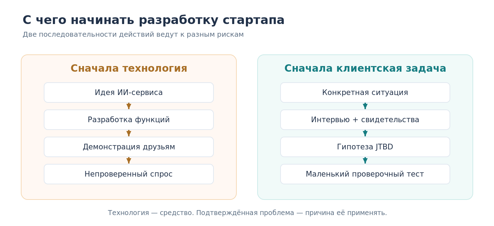
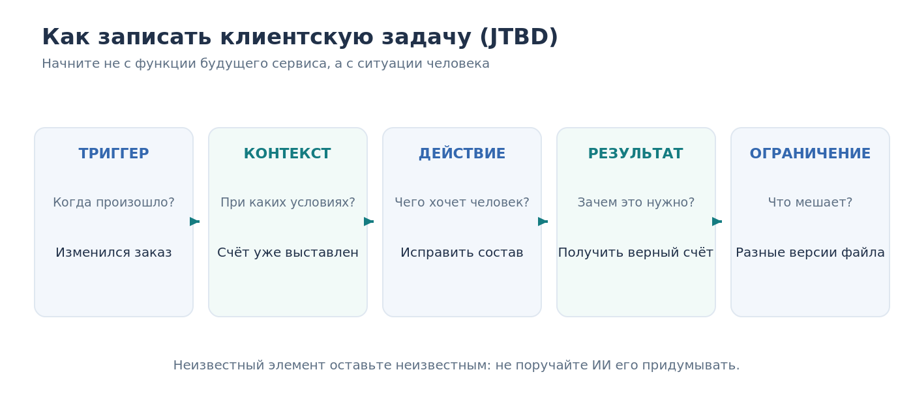
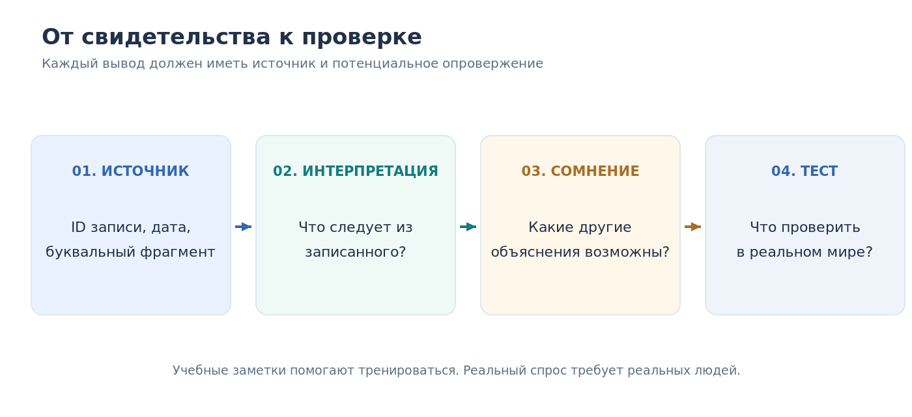

# Урок 02. Поиск проблемы, за решение которой платят

**Курс:** AI-Native Startup — от проблемы клиента до работающего сервиса  
**Неделя:** 1 · **Занятие:** 2 из 12  
**Версия:** 1.0 · **Дата:** 14 октября 2026 года  
**Время:** занятие 100 минут; самостоятельная работа 30–45 минут активного времени (организация контактов может занять дополнительные дни)  
**Подготовка:** три файла сквозного проекта из урока 01  
**Инструменты:** Markdown/текстовый редактор, электронная таблица и доступный ИИ-ассистент. Программирование не требуется.

> **Главный вопрос:** откуда мы знаем, что проблема существует в жизни реальных людей, а не только в нашем воображении и разговорах с ИИ?

## Чему вы научитесь

Вы научитесь выделять узкую группу потенциальных клиентов (ICP), задавать вопросы об их реальном прошлом опыте, описывать клиентскую задачу в логике *Jobs To Be Done* (JTBD), различать факты, свидетельства и гипотезы, использовать ИИ для анализа интервью без выдумывания цитат, а затем выбирать маленькую проверку серьёзности проблемы.

Ваш результат — четыре новых проектных артефакта и план разговора с реальными людьми. **Пока это не доказательство наличия рынка.** Исследование только начинается.

---

## 1. Сцена: «Все сказали, что идея прекрасная»

Ирина и Максим из первого урока сделали первый прототип: ИИ читает обращения покупателей, сортирует жалобы и готовит отчёт с советами. Прототип выглядит аккуратно. Его можно продемонстрировать за три минуты.

Ирина показывает программу трём знакомым. Все говорят: «Классно!». Один даже предлагает добавить чат-бота, который будет вести переписку с покупателем. Максим торжествует: «Значит, людям нужно. Давай две недели дорабатывать».

Но они не знают ни одного ответа на трудные вопросы: кто сегодня анализирует обращения, сколько времени уходит на анализ, кто страдает от ошибок, как проблема решается сейчас, какой ущерб она приносит и кто вправе покупать новое программное обеспечение.

Сравните это с иной беседой:

> «В прошлую пятницу клиент четыре раза спрашивал дату отгрузки. Мы отвечали, что уточним на складе, но сами не видели статус. Я каждое утро веду таблицу и звоню логисту».

*Это специально сочинённый учебный фрагмент из записи I02; реальное интервью ещё не проводилось.*

Вторая история говорит не о предполагаемом интересе к ИИ, а о **конкретной ситуации и действиях человека**. Мы можем выяснить, сколько времени ушло, как часто повторяется эпизод, почему данные не видны и кто платит за исправление процесса.

Но пока она также ничего не доказывает о необходимости нашего ИИ-сервиса. Возможно, полезнее обычная передача статуса из складской системы.

**Вопрос-прогноз:** какое из двух высказываний лучше помогает обнаружить клиентскую проблему? Что именно делает его более полезным?



---

## 2. Проблема — не то же самое, что решение

Основатель влюблён в идею: «Сделаем ИИ-аналитика для телефонных звонков». Он спрашивает: «Хотели бы вы такой сервис?». Если собеседник отвечает «да», основатель считает гипотезу проверенной. На самом деле проверена лишь вежливая реакция на предложение.

Разделим четыре уровня:

| Уровень | Пример | Что пока известно |
|---|---|---|
| Событие | Покупатель звонил насчёт отгрузки | Событие — если есть реальный источник |
| Причина | Клиент не получил понятного уведомления | Пока гипотеза |
| Возможное изменение | Автоматически сообщать статус доставки | Вариант решения |
| Продукт | Продавать ИИ-подписку для анализа всех обращений | Бизнес-гипотеза |

В первом уроке были условные 100 обращений: 40 — о корректировке заказа, 25 — о сроках доставки, 15 — об ошибках в счёте, 12 — о характеристиках товара, 8 — другие. Эти цифры помогают учиться, но они **синтетические**.

Даже будь они настоящими, 40 обращений ещё не означают 40 разных клиентов, а причина звонка не обязательно совпадает с первопричиной проблемы. Человек мог позвонить трижды. Другой покупатель мог вообще отказаться от заказа молча. Продавец мог ошибиться в документах, хотя сайт работал безупречно.

Из этого следует правило: **не пытайтесь исправить предполагаемую причину до того, как узнаете последовательность реальных действий**.

### Проверьте различие

«У нас длинные инструкции на сайте, поэтому покупатели не могут редактировать заказы» — это уже интерпретация.

«В пятницу покупатель попросил убрать две позиции; сотрудник удалил их вручную и переслал счёт» — описание события, которое можно попытаться подтвердить документами и журналом работы.

Интерпретация может оказаться верной — или нет. Но у неё должен быть способ проверки.

---

## 3. Кто именно должен стать клиентом?

В небольшом B2B-сервисе роль пользователя и роль покупателя не всегда совпадают.

- **Пользователь** непосредственно работает в программе: например, руководитель клиентской поддержки.
- **Покупатель** оплачивает услугу либо инициирует её оплату.
- **Согласующий** определяет, можно ли внедрить сервис и какие данные разрешено передавать.
- **Получатель пользы** может вообще не видеть программу: например, покупатель оборудования, который стал быстрее получать корректный счёт.

Один предприниматель иногда совмещает все четыре роли; в организациях они распределены между людьми.

*ICP (Ideal Customer Profile)* — полезное сокращение для **рабочего профиля тех, кого мы собираемся исследовать первыми**. Это не доказанный портрет рынка, а гипотеза о наиболее подходящем типе клиента.

Для учебного проекта возьмём первоначальный сегмент:

> Небольшие B2B-поставщики оборудования, у которых несколько менеджеров одновременно обрабатывают заказы, а собственник или руководитель продаж способен договориться о небольшом пилоте.

Почему именно такой сегмент? Мы можем узнать роли участников, изучить повторяющиеся заказы и счета и проверить, есть ли экономически заметная проблема. Но размер сегмента и ценность предлагаемой услуги остаются неизвестными.

### Как выбрать первых собеседников

Ищите людей, лично сталкивавшихся с соответствующей задачей. Это могут быть собственники малых компаний, руководители продаж, операторы поддержки, специалисты по закупкам. У каждого будет особый взгляд.

Первые пять разговоров лучше проводить внутри **одного предварительно выбранного типа компаний**, иначе ответы людей о совершенно разных процессах окажутся несопоставимы.

Пять интервью — учебный старт, **не статистическая выборка и не правило достаточности**. Количество разговоров само по себе не подтверждает распространённость проблемы. Нам важно качественно восстановить несколько конкретных ситуаций, а затем решить, какие данные собирать дальше.


## 4. Jobs To Be Done: «работа», ради которой люди пользуются продуктом

Человек покупает не список функций, а возможность справиться с какой-то задачей. Это центральная идея *Jobs To Be Done* (JTBD), которую Красинский активно использует при анализе клиентских обращений. Например, клиенту не нужен экран «редактирование счёта» сам по себе. Он хочет получить корректные документы к определённому сроку.

Запишем клиентскую задачу простым языком:

**Когда** [возникает конкретная ситуация], **я хочу** [выполнить действие], **чтобы** [получить полезный результат], **но меня ограничивает или беспокоит** [препятствие, риск].

Предположим, руководитель продаж говорит:

> Когда клиент меняет состав заказа уже после выставления счёта, я хочу получить одну актуальную версию документа, чтобы покупатель оплатил верную сумму вовремя; я опасаюсь, что сотрудники отправят разные версии.

В этом описании нет ИИ, диаграмм, кнопок или подписки. Причина проста: пока мы описываем **работу клиента**, а не наш продукт.



### Что уточнять за каждым элементом

**Ситуация.** Что заставило действовать? Изменился заказ, пришло письмо, понадобилось согласование?

**Контекст.** Почему сейчас это сложно? Мало времени, несколько отделов, нельзя исправить документ без звонка?

**Действия и обходные пути.** Что человек сделал на самом деле? Звонил, переносил данные, писал в чат, поручал сотруднику?

**Результат.** Как выглядело бы успешное завершение задачи? Точный счёт, своевременная поставка, отсутствие повторных звонков?

**Препятствия.** Что может помешать? Ошибочная сумма, невозможность подтвердить изменение, отсутствие доступа к складу?

Иногда мы не знаем одного из элементов. Тогда честно записываем «не выяснено» — это подсказка для следующего вопроса, а не приглашение ИИ придумать недостающий ответ.

У JTBD существуют разные методологические школы. Наш шаблон намеренно упрощён: он предназначен для первых исследований небольшой IT-компании, а не выдаётся за единственный научно правильный формат.

### Не перепутайте JTBD с должностной инструкцией

«Менеджер должен обработать 30 звонков» — описание его задания.

«Когда клиент не понимает статус отгрузки, менеджер хочет быстро дать достоверный ответ, чтобы покупатель мог планировать работу» — описание клиентской задачи в ситуации.

В первом случае мы сразу думаем, как увеличить скорость звонков. Во втором — почему вообще возникает необходимость узнавать статус через телефон.

---

## 5. Как брать интервью и не навязывать ответ

Разговор с потенциальным клиентом должен помогать вам **изучать его реальные действия**, а не проверять, насколько убедительно вы рекламируете будущий сервис.

Y Combinator рекомендует спрашивать о последних конкретных ситуациях и существующих обходных решениях. Nielsen Norman Group подчёркивает необходимость открытых вопросов и осторожного отношения к тому, как люди вспоминают прошлые события.

Пять основных вопросов для первого интервью:

1. «Расскажите о последнем случае, когда пришлось исправлять заказ или счёт».
2. «Что происходило до этого и почему задача возникла именно тогда?»
3. «Как вы действовали шаг за шагом?»
4. «Что в этой ситуации потребовало больше всего времени или усилий?»
5. «Что вы уже пробовали, чтобы подобное случалось реже?»

Далее следуют уточняющие вопросы: «Когда это было?», «Кто участвовал?», «На каком шаге пришлось ждать?», «Чем всё закончилось?», «Есть ли обезличенный пример документа или журнал события, который можно проверить?».

### Неудачные и более полезные вопросы

| Неудачный вариант | Лучше спросить |
|---|---|
| «Вам же нужен наш ИИ-бот?» | «Что вы используете для решения этой задачи сейчас?» |
| «Вы бы платили 99 евро в месяц?» | «За что вы уже платили, пытаясь справиться с этой проблемой?» |
| «Неудобно же всё делать вручную?» | «Опишите последний случай: где началась ручная работа?» |
| «Каких функций вам не хватает?» | «Что помешало завершить задачу в прошлый раз?» |
| «Вы обязательно бы пользовались?» | «Как вы действовали в предыдущей подобной ситуации?» |

**Почему вопросы о прошлом полезнее?** Рассказ о конкретном эпизоде позволяет уточнять участников, действия, время и последствия. Вопрос о гипотетическом будущем часто рождает вежливые обещания без обязательств.

Но и прошлые события люди вспоминают неточно. Поэтому слова «обычно два часа» или «раз двадцать в неделю» записываем как **оценку собеседника**, а не как доказанную измеренную статистику.

### Что делать с похвалами и возражениями

Если человек говорит «интересно», поблагодарите, но не считайте это покупкой. Верните разговор к недавним случаям. Если говорит «мне такое не нужно», не пытайтесь обязательно переубедить. Уточните, как он решил подобную задачу и что использует сегодня.

Противоречащие нашей идее интервью могут быть полезнее удобных подтверждений. Возможно, рынок уже хорошо обслуживается, задача возникает слишком редко или клиент не испытывает заметных потерь. Чем раньше мы обнаружим это, тем меньше бесполезной работы сделаем.

---

## 6. Сценарий первых 15 минут

Обычно достаточно спокойного короткого разговора. Не пытайтесь прочесть длинную анкету, пока собеседник вспоминает важную деталь.

| Время | Действие |
|---|---|
| 0–2 мин | Представиться, объяснить цель, договориться об условиях использования заметок |
| 2–4 мин | Уточнить роль собеседника и какой процесс он выполняет |
| 4–10 мин | Подробно восстановить последний конкретный эпизод |
| 10–13 мин | Спросить об обходном решении, частоте, последствиях и участниках решения |
| 13–15 мин | Пересказать услышанное, попросить поправить ошибки, договориться о возможном продолжении |

Спросить о времени и деньгах бывает непросто. Начните с факта: «Кто занимался этим в последний раз?», «Сколько шагов потребовалось?». При возможности попросите показать **разрешённый, предварительно обезличенный** пример работы. Если человек отвечает «не знаю» — это полезное знание о неопределённости.

Если разговор начинает превращаться в обсуждение функций, мягко верните его к действию: «А как вы справились в последний раз без такой функции?»

### Граница между исследованием и продажей

На исследовательском интервью мы изучаем проблему. Согласование цены, показ работающего пилота и заключение договора — отдельные действия. Их можно выполнить позже, когда известен клиентский сценарий.

Фраза «я бы подписался» не равна подписке. Более сильные сигналы — существующие расходы на решение проблемы, предоставленный для анализа материал в рамках согласованного пилота, назначенная встреча с человеком, который принимает решение, или платёж. Но даже платный пилот не доказывает, что будущий масштабный продукт будет работать.

### Как обращаться с записями и личными данными

Перед реальным интервью информируйте участника о цели разговора, сборе и использовании данных. Для аудиозаписи, передачи текста стороннему ИИ, хранения и удаления нужна отдельная оценка правового основания и необходимых условий. По GDPR согласие является **одним из возможных** оснований, а не универсальной заменой всем требованиям. Старайтесь не собирать личные данные и коммерческие секреты без необходимости; учебную практику проводите на синтетическом корпусе.


---

## 7. От рассказа к свидетельству: реестр, а не красивая история

Допустим, собеседник рассказал:

> «Я каждое утро звоню складу, иначе не могу ответить, когда отгрузят заказ».

Не спешите делать вывод «нужна автоматизация на основе ИИ». Между рассказом и решением есть несколько проверок.

| Что записываем | Пример | Статус |
|---|---|---|
| Что именно сказал человек | «Каждое утро звоню складу» | Цитата из заметки |
| Какое действие он описал | Ручное уточнение статуса | Сообщение собеседника о своём поведении |
| Какую причину предполагаем | Нет доступного статуса отгрузки | Гипотеза |
| Какую проверку назначим | С разрешения посмотреть цепочку «склад → продавец → клиент» | План проверки |
| Какой продукт предложить | Автоматическая передача статуса или иной способ | Пока вариант |

В архиве имеется **реестр свидетельств** — `06_evidence_register.csv`. Его важнейшие поля: `source_id`, `exact_excerpt`, `evidence_kind`, `inference`, `open_question`, `source_status`.

Никогда не делайте вид, что фраза из отчёта ИИ была сказана человеком, если вы не можете найти её в записи. Если первичных заметок нет, разумно написать: «не подтверждено».

### Положительные и отрицательные свидетельства

Учебный собеседник `I01` рассказывает о недавней проблеме с версиями счёта, временной таблице и прошлой оплате помощи подрядчика. Это полезный сигнал о неудобстве, но оплаченное решение было **другим**, а не нашим сервисом.

Собеседник `I03` говорит, что исправил счёт за пять минут и не испытывает значительных затрат. Это неудобный, но важный пример против версии «каждому поставщику нужен новый сервис».

Собеседник `I07` с энтузиазмом фантазирует об ИИ-боте, но не может назвать ни одного недавнего обращения. Приятная оценка продукта не равна выявленной проблеме.

Именно эти три записи преподаватель будет сравнивать на демонстрации.

### Почему «пять почему» не доказывают причинность

Красинский подчёркивает необходимость искать первопричины, а не просто ускорять обработку жалоб. Это важная эвристика. Однако одинаковый симптом может возникать по разным причинам: из-за ошибки интерфейса, неверных цен, отсутствия данных, ограничений склада, неверного распределения ответственности.

Поэтому «пять почему» — способ *породить проверяемые объяснения*, а не доказать их. Если вам кажется, что причина очевидна, назовите хотя бы одну альтернативную гипотезу и способ её отличить от вашей.

---

## 8. Что ИИ делает хорошо, а чего делать не должен

На втором уроке мы не создаём армию агентов. Нам полезен один ассистент, выполняющий четыре понятные роли.

**Редактор вопросов.** ИИ проверяет, не навязывает ли интервью будущий продукт. Он может превратить «Купили бы вы?» в вопрос о прошлых покупках и затратах.

**Классификатор заметок.** ИИ выделяет ситуации, действия, ограничения, обходные решения и неизвестные параметры. Для каждого вывода он обязан привести `ID` и точный фрагмент из исходной записи.

**Критик гипотезы.** ИИ ищет несогласующиеся случаи, неподходящие сегменты, слабые свидетельства и альтернативные причины.

**Планировщик теста.** ИИ предлагает минимальный следующий эксперимент, который можно выполнить без большой разработки.



Есть и жёсткие ограничения. ИИ **не должен** притворяться реальным опрошенным покупателем, выдумывать цитаты или объявлять спрос подтверждённым. Он не должен рассылать письма без одобрения и не должен получать чужие записи разговоров только потому, что умеет их анализировать.

Исследователи Nielsen Norman Group отдельно указывают, что «синтетические пользователи» могут помогать готовить исследование, но не заменяют настоящих участников. В нашей практике учебный набор целиком выдуман, поэтому результат на нём показывает лишь **освоение способа анализа**, а не коммерческую перспективность стартапа.

---

## 9. Демонстрация: двенадцать несовпадающих историй

Откройте `data/interview_notes_12_unlabeled.csv`. Здесь собраны двенадцать вымышленных заметок о случаях в торговле оборудованием, работе со счетами и сообщениях о доставке. Они специально устроены так, чтобы нельзя было просто получить единодушное «да».

Некоторые люди описывают недавнюю болезненную проблему. Другие уже решили её обычной программой. Третьи не могут принимать решения о покупке. Есть и участники со смежных сторон процесса — покупатель или логистический партнёр.

В первой демонстрации преподаватель предлагает три записи `I01`, `I03`, `I07`.

1. Прочитайте их **до обращения к ИИ**.
2. Для каждой выделите последнее конкретное событие, обходной путь, экономический сигнал и полномочие на покупку.
3. Запустите промпт `P03` из `PROMPTS.md`.
4. Сравните каждое утверждение агента с буквальным текстом записи.
5. Отметьте хотя бы одно обстоятельство, которое **может опровергнуть** вашу исходную идею.

Если агент сказал «в I07 человек согласился купить», покажите ему исходную строку: этого там нет. Если агент перепутал оплату подрядчика с оплатой ИИ-продукта, не принимайте такую интерпретацию.

**Хороший анализ сохраняет неопределённость.** Он не обязан закончиться оптимистичным выводом.

---

## 10. Практика: готовим первые реальные интервью

Для начала откройте три файла собственного проекта из урока 01:

`01_startup_hypothesis.md`, `02_workflow_map.md`, `03_success_metrics.md`.

Пока это гипотезы, а не достигнутые результаты. Мы не будем стирать их историю — мы дополним их новыми вопросами.

### Шаг 1. Выберите один сегмент

Запишите:

> «Сначала мы изучаем [конкретную роль] в [типе компании], которая сталкивается с [ситуацией] при [контексте]».

Не пытайтесь охватить весь рынок. Напишите, чем эта группа отличается от ближайших альтернатив и почему вы можете с ней поговорить.

### Шаг 2. Сформулируйте JTBD

Используйте схему «Когда — хочу — чтобы — опасаюсь». Незаполненные места отмечайте `?`, а не сочиняйте. Важно, чтобы формулировка описывала **задачу клиента без названия вашего будущего продукта**.

### Шаг 3. Перепишите вопросы

Подготовьте пять открытых вопросов о прошлом поведении и по два уточнения. Затем попросите ИИ найти наводящие или оценочные формулировки. Примите не все исправления подряд, а те, что действительно помогают узнать о прошлом опыте.

### Шаг 4. Изучите учебные заметки

Вручную разберите **шесть** записей из корпуса `I01–I12`. Отметьте четыре признака: подходит ли роль вашему сегменту, есть ли конкретное событие, есть ли обходное решение, имеются ли свидетельства затрат или полномочий на покупку.

После этого поручите ИИ проанализировать **все двенадцать** записей. Проверьте минимум три утверждения машины по исходному тексту и запишите её ошибки или недоказанные интерпретации.

### Шаг 5. Подготовьте приглашение

Например:

> «Я изучаю, как небольшие поставщики оборудования исправляют заказы и согласуют сроки доставки. Можно задать вам несколько вопросов о последнем подобном случае? Разговор займёт около 15 минут, ничего продавать не собираюсь».

Укажите реальную цель и форму использования данных. Если предполагается запись или передача заметок третьему сервису, это должно быть согласовано отдельно в соответствии с применимыми требованиями.

### Шаг 6. Спланируйте пять контактов

Выберите пять **профилей**, с которыми вы хотели бы поговорить, и отметьте, почему каждый подходит для исследования. Не записывайте чужие телефоны и адреса в общий учебный репозиторий. Реальные имена и контакты храните отдельно с соответствующими ограничениями доступа.

На этом занятие заканчивается. Весь учебный корпус — лишь тренировочная площадка. Подтверждение спроса начинается только после разговора с людьми.

---

## 11. Что делать после первых разговоров

Не существует магического числа интервью, после которого идея автоматически становится хорошей. Первые беседы могут привести к одному из трёх решений:

**Продолжить исследовать.** Если ситуация описана расплывчато, люди не относятся к вашему сегменту, неизвестна цена проблемы или данных слишком мало.

**Сузить или изменить гипотезу.** Если проблема встречается у определённой роли или оказывается связанной не с аналитикой, а с передачей статуса, редактированием счёта либо другой операцией.

**Готовить ограниченный пилот.** Если несколько подходящих людей описали конкретные недавние затруднения, используют неудобные обходные способы, и у вас появился путь к человеку, который может разрешить небольшой тест.

Это **эвристики для выбора следующего шага**, а не статистический критерий «рынок доказан». Полезность сервиса, цена и готовность платить проверяются отдельно.

К следующему уроку — «Как проверить бизнес-идею до разработки продукта» — вы принесёте не список функций, а описание клиентской задачи и план честного пилота.

---

## 12. Домашняя работа и созданные артефакты

Теперь папка стартапа должна включать четыре новых файла:

```text
my-ai-startup/
├── 01_startup_hypothesis.md    ← уточнить статус прежних предположений
├── 02_workflow_map.md          ← отметить неизвестные шаги
├── 03_success_metrics.md       ← сохранить
├── 04_customer_profile.md      ← новый
├── 05_interview_guide.md       ← новый
├── 06_evidence_register.csv    ← новый
└── 07_problem_decision.md      ← новый
```

`04_customer_profile.md` — выбранный ICP, роли и границы сегмента; `05_interview_guide.md` — вопросы и правила интервью; `06_evidence_register.csv` — исходные фрагменты с идентификаторами и статусом `SYNTHETIC` или `REAL`; `07_problem_decision.md` — текущая гипотеза, контрсвидетельства и следующий эксперимент.

**Домашнее задание:** за 30–45 минут активной работы отправить приглашения хотя бы двум релевантным людям, подготовить сценарий и при наличии возможности провести один 10–15-минутный разговор. Срок ожидания ответов не входит в активное время.

Если никто пока не согласился, сдайте журнал предпринятых попыток **без персональных данных**. Не заменяйте отсутствие собеседников беседой с вымышленной «ИИ-персоной» и не пишите «гипотеза подтверждена».

### Проверьте себя

1. Чем реальная история о прошлом заказе полезнее похвалы будущему ИИ-продукту?
2. Почему «всем нужно быстрее обрабатывать звонки» — возможно, неверная постановка задачи?
3. Может ли пользователь продукта не быть его покупателем?
4. Какие элементы JTBD нельзя заполнять без данных?
5. Почему десять синтетических интервью не доказывают размер рынка?
6. Что делать, если ИИ приводит цитату, которой нет в исходном файле?
7. Какой результат урока 02 становится входом урока 03?

## Короткий итог

На уроке 01 мы научились отличать активность и артефакт от пользы для клиента. На уроке 02 выяснили, **откуда можно получить знание о клиентской задаче**. Для этого необходимо разговаривать с подходящими людьми об их конкретном опыте, отделять свидетельства от объяснений и не скрывать противоречащие случаи.

ИИ ускоряет подготовку и анализ, но не создаёт настоящих покупателей и не подтверждает спрос одним убедительным отчётом. Главный итог — не новая программа, а **проверяемая модель проблемы и план её исследования в реальном мире**.

### Источники и степень подтверждения

**ЛЕКЦИЯ:** Илья Красинский о клиентских обращениях, JTBD и поиске корневых причин.  
**ВНЕШНИЕ ИСТОЧНИКИ:** Y Combinator (интервью о прошлом опыте), NN/g (методология и ограничения интервью; синтетические пользователи), Harvard Business School Online (смысл JTBD), EDPB (правовые основания и минимизация персональных данных). Ссылки и даты — в `06_ИСТОЧНИКИ_И_ОБНОВЛЕНИЯ.md`.  
**УЧЕБНЫЙ ПРИМЕР:** герои Ирина и Максим, все 12 записей, суммы, числа и истории в корпусе созданы для тренировки.  
**ГИПОТЕЗА:** что предлагаемый сервис нужен B2B-поставщикам и что они готовы за него платить.  
**МЕТОДИЧЕСКОЕ РЕШЕНИЕ:** 100-минутная структура, оценивание, набор учебных файлов.
