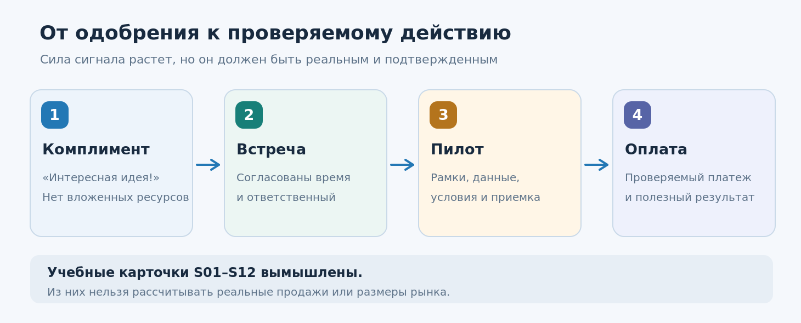
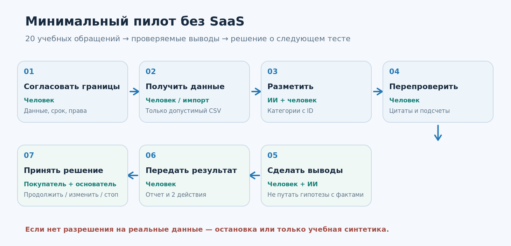
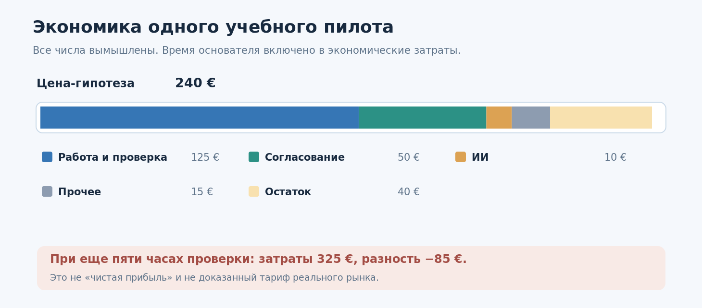

# Урок 03. Как проверить бизнес-идею до разработки продукта

**Курс:** AI-Native Startup — компания из 1–2 человек и команды ИИ-инструментов  
**Неделя:** 2 · **Занятие:** 3 из 12 · **Версия:** 1.0 · **Дата:** 14.10.2026  
**Время:** 100 минут; самостоятельная работа 30–45 минут активных действий  
**Вход:** файлы `04_customer_profile.md`, `05_interview_guide.md`, `06_evidence_register.csv`, `07_problem_decision.md` из урока 02. Если интервью ещё не состоялись, их **нельзя подменять** учебными симуляциями.  
**Инструменты:** текстовый редактор, электронная таблица, необязательный ИИ-ассистент. Программирование не требуется.

> **Главный вопрос урока:** как до разработки SaaS-системы обнаружить не только интерес к идее, но и конкретное действие потенциального покупателя, показывающее готовность потратить время, ресурсы или деньги на решение проблемы?

## Чему вы научитесь

К концу занятия вы сможете отделять словесное одобрение от коммерческих действий; описывать узкое проверяемое предложение (*offer*); проектировать ручной пилот с ИИ (*concierge MVP*); назначать цену как гипотезу; записывать сигналы спроса с указанием источника; оценивать стоимость выполнения пилота; ставить решение `CONTINUE / CHANGE / STOP / NOT_ENOUGH_EVIDENCE` по заранее записанным правилам. Ваш итог — **план ограниченного пилота**, а не готовая продающая программа и не доказательство Product–Market Fit.



---

## 1. Сцена: «Идея понравилась всем»

Ирина и Максим изучают, как B2B-поставщики оборудования обрабатывают правки заказов и вопросы об отгрузке. После предыдущего урока у них есть предположительный портрет клиента, JTBD-сценарий и заметки по интервью. Они уже способны показать, как ИИ собирает из обращения краткий отчёт.

Один собеседник сказал: «Супер!». Другой предложил добавить чат-бота. Третий попросил прислать ссылку. Максим хочет потратить две недели на код. Ирина предлагает сначала продать маленький результат: за пять рабочих дней изучить 20 разрешённых обращений, выделить повторяющиеся трудности, показать подтверждающие фрагменты и обсудить три практических изменения.

Покупатель отвечает: «Пришлите условия пилота. Могу согласовать до 300 евро, если пойму, какие данные нужны и как проверять качество». Это уже содержательнее, чем похвала, но **денег пока никто не заплатил**. Перед нами вымышленная сцена на основе учебной карточки `S01`. Она не служит доказательством реального спроса.

**Вопрос-прогноз:** что полезнее проверить завтра — возможность агента сделать ещё десять функций или готовность конкретного потенциального клиента выделить ресурс на ограниченный пилот? Какие действия покупателя вы сочтёте свидетельством интереса, а какие — обычной вежливостью?

### Важная граница

Не всякий стартап обязан получать оплату до первого прототипа. Для сложных продуктов, регулируемых отраслей, аппаратного обеспечения и длинных закупок первым проверяемым действием может быть встреча с владельцем бюджета, разрешённый доступ к тестовым данным или участие эксперта в пилоте. Однако такие сигналы **слабее фактически оплаченной и принятой услуги**. Мы должны называть их своими именами.

---

## 2. Четыре ступени: от интереса к результату

На уроке 01 мы различали деятельность (*activity*), произведённый артефакт (*output*) и изменение для клиента (*outcome*). На уроке 02 научились искать истории прошлых реальных событий и отделять свидетельства от интерпретаций. Теперь появляется ещё один вопрос: **кому настолько важно улучшение, что он готов участвовать в проверке и, возможно, купить его?**

Представьте лестницу доказательств:

| Сигнал | Что произошло | Что можно и нельзя заключить |
|---|---|---|
| Комплимент | «Очень интересная идея!» | Известна реакция, но не спрос |
| Действие | Согласован конкретный созвон с владельцем бюджета | Есть затрата времени; покупка не подтверждена |
| Доступ или согласованный пилот | Компания предоставляет допустимые тестовые данные, назначает ответственного, договаривается о результате | Появляется серьёзный шаг; оплата ещё неизвестна |
| Подтверждённый платёж / договор и приёмка услуги | Существуют проверяемые финансовые и договорные документы, услуга принята | Намного сильнее подтверждена возможность коммерческой сделки; масштаб рынка всё ещё неизвестен |

Сильный сигнал не отменяет проверку пригодности клиента: единичная оплаченная услуга может оказаться заказной консультацией, которая никогда не станет повторяемым продуктом. А в корпоративном B2B подписанный LOI (*letter of intent*, письмо о намерениях) может быть полезным промежуточным шагом; его обязательность и юридические последствия зависят от текста и права. **LOI сам по себе не является оплаченной продажей.**


### Как не обмануть себя

Для каждого контакта записывайте: `что человек сказал`, `какой шаг действительно сделал`, `когда`, `кто принимает решение`, `сколько стоит проверка для клиента`, `чего мы пока не знаем`. Если участие ограничилось обещанием «потом посмотрим», это не оплаченный заказ. Если сформирован счёт, но он не оплачен, это выставленный счёт, а не выручка. Если предложена цена, но собеседник молчит, это неопределённый результат, а не обязательно отказ.

---

## 3. Вместо программы — проверяемый оффер

**Оффер** — это понятное предложение конкретному покупателю: для кого, в какой ситуации, что он получит, в какие сроки, при каких условиях и за какую цену или ресурс. Это не список кнопок и не инструкция агенту.

Сравните два описания.

**Слабое:** «Наш инновационный ИИ анализирует заявки, интегрируется с CRM, строит граф знаний, генерирует таски и автоматически улучшает продажи».

**Сильнее:** «Для небольшого поставщика оборудования мы за пять рабочих дней разберём 20 согласованно переданных, предварительно обезличенных обращений, покажем 3–5 повторяющихся проблем с точными ссылками на примеры и предложим два недорогих действия для проверки. Сначала владелец получает короткий образец отчёта; затем стороны решают, есть ли смысл в платном пилоте. Мы не обещаем увеличить продажи без последующего измерения».

У второго варианта есть проверяемый результат. Но мы ещё должны убедиться, что покупатель считает его ценным. Может оказаться, что ему нужен не аналитический отчёт, а исправление процесса выставления счетов; тогда оффер придётся изменить. Это нормальный результат исследования.

### Семь полей минимального оффера

1. **Кому:** узкий ICP и роль покупателя, например собственник небольшого B2B-поставщика.
2. **В какой ситуации:** конкретная неприятность, подтверждаемая настоящими клиентскими историями.
3. **Что будет сделано:** ограниченный объём работ, например 20 обращений из разрешённой выборки.
4. **Что клиент получит:** отчёт на одной странице, таблицу подтверждений, план двух проверок.
5. **Как принимается работа:** воспроизводимые критерии и сроки обратной связи.
6. **Цена или условия теста:** гипотеза цены, бесплатный пример либо согласованный платный пилот; никто не обязан платить ради учёбы.
7. **Что исключено:** постоянное наблюдение за CRM, автономное изменение данных, юридическая оценка, обещание роста выручки.

Прайс **нельзя выводить только из себестоимости**. Цена зависит от ценности для конкретного клиента, альтернатив и закупочного процесса. Себестоимость нужна, чтобы не продавать заведомо убыточную услугу, но она не доказывает готовность покупать.

---

## 4. Три пути к MVP без большой разработки

*MVP* (Minimum Viable Product) здесь — минимальный способ предоставить полезное решение и получить наблюдение о его использовании. Это **не обязательно код и не обязательно самостоятельная SaaS-платформа**.

| Формат | Что происходит | Что проверяем | Риск |
|---|---|---|---|
| Разбор вручную (*concierge*) | Основатель сам выполняет большую часть работы, ИИ помогает | Нужен ли клиенту результат вообще | Не повторяется без человека |
| «За кулисами» с автоматизацией | Покупатель видит простой интерфейс, часть работы выполняют человек и инструменты | Как удобно получать результат | Нельзя ложно представлять услугу как полностью автоматическую; нужна прозрачность условий |
| Узкий цифровой прототип | Один автоматизированный маршрут, без полноценной админки | Работает ли критическая часть процесса | Разработка может отвлечь от выяснения спроса |

Первые два формата особенно подходят команде из одного-двух человек: предприниматель получает контакт с реальностью и не тратит месяцы на сложную архитектуру. Paul Graham в статье *Do Things That Don't Scale* описывает, почему ручная работа с первыми пользователями помогает выяснить настоящие потребности. Важно, однако, не спутать метод изучения клиента с вечной моделью безлимитного консалтинга.



### Пример услуги «20 обращений»

1. Основатель согласует проблему, владельца решения и допустимые данные.
2. Клиент предоставляет синтетический или безопасно подготовленный набор; для реальных данных отдельно определяются правовое основание, полномочия и условия обработки.
3. Человек/ИИ классифицирует проблемы, сохраняя ID исходных обращений.
4. Второй проход проверяет цитаты и обнаруживает ошибки классификации.
5. Основатель формирует 3–5 наблюдений и **гипотезы**, не выдавая гипотезы за доказанные первопричины.
6. Заказчик получает отчёт и предлагает одно конкретное действие.
7. Стороны решают, нужен ли следующий эксперимент; улучшение бизнес-метрик измеряется **после внедрения**, не в момент получения отчёта.

**Проверка качества:** нельзя придумать ни одной цитаты. Подсчёты должны воспроизводиться по таблице. Персональные данные и коммерческая тайна не должны поступать в незнакомый сервис без надлежащих разрешений.

---

## 5. Что такое «продать пилот», а не «продать надежду»

Цель пилота — не убедить клиента купить абстрактный ИИ, а показать **маленький результат с проверяемыми границами**. Поэтому в кратком соглашении о пилоте следует указать:

- исполнителя и заказчика (или учебные роли), срок, объём, допустимые входные данные;
- точный состав результата, способ приёмки, критерии отказа от результата;
- кто и при каких условиях может запускать ИИ-инструменты;
- что происходит при ошибке, задержке или невозможности продолжать;
- стоимость, порядок согласования и оплаты — только в настоящей коммерческой работе;
- срок хранения и удаления данных, конфиденциальность и разрешения;
- следующий шаг после пилота, который не подразумевает обязательное приобретение постоянной подписки.

Это учебная схема требований, **не готовый договор и не юридическая консультация**. Для реального пилота нужно проверить применимое право, правила обработки данных и форму документов.

**Пример ограничения автономности:** ИИ может подготовить черновик коммерческого предложения, но отправка клиенту выполняется человеком после проверки. ИИ может прочитать разрешённый CSV, но не получает доступ ко всему CRM по умолчанию.

---
## 6. Как проверять готовность платить

Спросите клиента не просто «купили бы вы сервис за 240 евро?», а предложите **конкретный следующий шаг, за который человек действительно отвечает**: встречу с лицом, принимающим финансовое решение; согласование состава платного пилота; при готовности — договор и оплату через легальный бизнес-процесс.

Цена в размере **240 евро** здесь полностью **учебная**, не рыночная рекомендация. У неё нет универсальной правильности. Один B2B-клиент может с готовностью оплатить подобную услугу, другой получит тот же результат в существующей системе. Реальное предложение зависит от юрисдикции, объёма работ, данных, налогов и договорённостей.

### Не перепутайте ступени коммерческой воронки

- **Ответ на сообщение:** ещё не согласие на разговор.
- **Состоявшаяся встреча:** интерес и потраченное время, но не платёж.
- **Запрос цены:** повод уточнить ценность, не подтверждение бюджета.
- **Обещание «вписать в бюджет»:** заявление, которое предстоит проверить.
- **Выставленный счёт:** не выручка; он может остаться неоплаченным.
- **Подписанный LOI:** промежуточный сигнал; юридическое значение зависит от содержания.
- **Полученный платёж:** подтверждение конкретной сделки, но ещё не повторяемости бизнеса.
- **Приёмка результата и повторный заказ:** дополнительные подтверждения ценности и возможности повторения.

Для первого занятия не требуется выставлять реальные счета или получать предоплату. Мы учимся правильно проектировать коммерческий эксперимент. Настоящие сделки совершаются позже и только в рамках применимого законодательства.

### Проверяемая гипотеза и порог решения

До опыта запишите: «Для узкого сегмента B2B-поставщиков наше предложение полезно; в течение двух недель после первых контактов мы ожидаем, что из пяти соответствующих лиц, принимающих решение, хотя бы двое выделят время на предметное обсуждение пилота, а хотя бы один обсудит конкретные условия платного запуска».

Это **пример заранее сформулированной учебной эвристики**, а не статистическое правило. Не следует трактовать 2/5 как оценку доли покупателей на рынке или менять порог задним числом, чтобы объявить эксперимент удачным. Если контактов не было, вывод — `NOT_ENOUGH_EVIDENCE`, а не «рынка нет». Для длинных B2B-циклов сроки и типы обязательств нужно выбирать разумно.

---

## 7. Первая экономика: прибыль — не только «цена минус токены»

Создать один отчёт с ИИ может быть недорого. Но предприниматель тратит время на общение с клиентом, выбор данных, проверку цитат, объяснение результата и исправление ошибок. Время основателя нельзя считать бесплатным, даже если деньги пока не выводятся со счёта.

**Пример учебного пилота, все значения условные:**

| Компонент одного пилота | Расчёт | Стоимость |
|---|---|---:|
| Ручной анализ и проверка | 5 часов × 25 €/час | 125 € |
| Коммуникация и согласование | 2 часа × 25 €/час | 50 € |
| Использование ИИ | Учебная оценка | 10 € |
| Прочие переменные расходы | Учебная оценка | 15 € |
| **Итого экономических затрат в упражнении** | | **200 €** |
| **Предположительная цена** | | **240 €** |
| **Остаток после этих затрат** | 240 − 200 | **40 €** |

Отношение этого остатка к цене — **16,7%**. Это иллюстрация экономики **одного условного заказа** с вменённой оценкой труда, не строгий показатель бухгалтерской валовой маржи. Здесь не учтены налоги, постоянные издержки, безуспешные продажи, возвраты, простой, поддержка и юридические расходы. Для настоящей экономики следует отдельно учитывать денежные платежи и затраты времени, а затем выяснить, можно ли снизить стоимость производства без потери качества.

**Вопрос:** если клиент согласен платить только 100 €, а выполнение занимает семь часов, станет ли компания жизнеспособной лишь благодаря дешёвым токенам? Нет. Возможно, цену нужно обосновать иначе, сузить объём услуги либо отказаться от этого сегмента.



---

## 8. Как применять ИИ на стадии проверки идеи

ИИ может ускорить подготовку: он помогает сформулировать оффер, подготовить альтернативную гипотезу, разработать чек-лист пилота, структурировать таблицу обращений и проверить внутреннюю непротиворечивость расчётов.

ИИ **не может** без источников доказать, что покупатель действительно заинтересован, что деньги поступили на счёт, что интервью состоялось, что документ подписан или что обещанный экономический эффект наступил. У него нет доступа к закрытой реальности по умолчанию.

Полезный рабочий процесс:

1. Основатель предоставляет **только разрешённые или учебные** данные и явно помечает их происхождение.
2. ИИ составляет черновик одного узкого оффера.
3. ИИ выступает критиком: находит недоказанные обещания, скрытые расходы, чрезмерный объём и зависимость от закрытых данных.
4. Человек исправляет оффер и лично проверяет реакцию потенциальных заказчиков.
5. ИИ структурирует **наблюдаемые действия** в журнале, не приписывая собеседнику несуществующие решения.
6. Основатель выбирает следующий эксперимент.

> **Полезный принцип Красинского (ЛЕКЦИЯ, пересказ):** клиент платит за важный для него результат, а не за видимость сложности технологии. В исходном выступлении обсуждается небольшой партнёрский пилот и показ проблем на ограниченном наборе обращений. В нашем уроке добавлены явные границы объёма, качество, данные и честная проверка платежеспособности.

### Показательные формулировки заданий ИИ

**Для оффера:** «Возьми только факты из приложенного `07_problem_decision.md`. Сформулируй одно предложение для роли покупателя. Укажи, какие утверждения недоказаны, и не обещай измеримого роста продаж без испытания».

**Для критика:** «Найди способы, которыми клиент мог бы получить тот же результат без нашего ИИ-сервиса. Назови признаки, при которых пилот следует остановить. Проверь, соответствует ли цена объёму работ».

**Для коммерческих ответов:** «Прочитай сообщения S01–S12. Не воспринимай их как реальные контакты. Для каждого выдели действие, обещание, отсутствие действия, роль владельца бюджета и самый честный следующий шаг. Не добавляй фактов».

В папке `PROMPTS.md` находятся полные проверяемые версии этих запросов и промпты независимой проверки.

---

## 9. Демонстрационный разбор: 12 ответов на предложение

Теперь получим практику на **синтетическом корпусе из 12 карточек**. Их роли связаны с персонажами `I01–I12` прошлого урока, но все новые реплики специально написаны для занятия. Это вымышленное продолжение учебной истории, **не реальные продажи и не реальные платежи**.

Файл `data/buyer_reactions_12_unlabeled.csv` содержит сообщения. Доступ к колонкам учительской классификации вы получите после собственного анализа.

Начните с трёх карточек:

- `S01`: собственник говорит, что **мог бы** выделить до 300 €, но просит условия и требования к данным. Это заявление о возможном бюджете, **не оплата**.
- `S03`: собственник прямо говорит, что исправляет редкую ошибку за пять минут, пилот не нужен. Это **контрпример** для нашей гипотезы.
- `S07`: маркетолог обещает поставить сердечко и переслать ссылку. Это **комплимент**, не действие владельца бюджета.

Попробуйте объяснить, почему все три карточки необходимы. Если оставить только S01, вы переоцените рынок. Если игнорировать S03 и S07, вы утратите информацию о неправильном сегменте и пустых сигналах интереса.

Не пишите «один из двенадцати готов платить». Такой вывод был бы ошибочным дважды: записи вымышлены, а S01 лишь допустил бюджет. В реальной работе мы должны сохранять не только положительные, но и отрицательные и неопределённые ответы.

---

## 10. Практика: соберите пилот, не создавая SaaS

**Длительность:** 35 минут. Практика продолжается в рабочей тетради; весь урок рассчитан на 100 минут с объяснением и проверкой.

**Шаг 1.** Откройте `07_problem_decision.md` из урока 02. Если там лишь учебные данные, напишите `NOT_YET_VALIDATED`. Выберите одну проблему и одного предполагаемого покупателя. Если подтверждённые реальные наблюдения есть, укажите их источник и разрешённость использования.

**Шаг 2.** Напишите оффер в пределах 120–180 слов. Он должен обещать только то, что можно проверить и исполнить малой командой. Не использовать слова «гарантированно увеличим продажи» и «полностью автономно», пока это не подтверждено.

**Шаг 3.** Заполните протокол пилота: 20 учебных/обезличенных обращений, 5 рабочих дней как учебный срок, 3–5 наблюдений с цитатами, критерий приёмки, контактное лицо и процедура остановки при отсутствии прав на данные. Числа — **условия учебной задачи**, не обязательная универсальная конфигурация сервиса.

**Шаг 4.** Прочитайте `buyer_reactions_12_unlabeled.csv`. Вручную классифицируйте не менее шести карточек по наблюдаемому действию. Затем сравните с анализом ИИ; проверьте каждую цитату по исходной строке. Не превращайте слова «возможно», «посмотрим» и «пришлите» в подтверждённую покупку.

**Шаг 5.** Заполните простую таблицу стоимости пилота. Отдельно обозначьте денежные расходы и оценку труда основателя. Составьте два варианта цены или объёма и сформулируйте, что нужно узнать от покупателя.

**Шаг 6.** До будущих контактов запишите минимальный критерий решения и завершите карту рисков: кто предоставляет данные, кто может отправить коммерческое предложение, как проверить результат, кто способен остановить процесс.

**Шаг 7.** Выберите честный исход: `CONTINUE` (есть достаточные реальные основания для следующего ограниченного шага), `CHANGE` (надо пересмотреть сегмент/оффер), `STOP` (обоснованное решение не продолжать в этом виде) или `NOT_ENOUGH_EVIDENCE` (нет реальных данных). Использование только учебного набора допускает **лишь четвёртый исход относительно настоящего рынка**.

### Технический трек без обязательного программирования

Таблицы можно вести в любом редакторе CSV или электронной таблице, а оффер — в Markdown. Кодовый факультатив: проверить структуру своих таблиц и расчёт экономики собственным скриптом или формулами. Эталонный скрипт `demo/check_package.py` сверяет учебные ID с ключом, поэтому остаётся у преподавателя.

---

## 11. Проверьте свой результат

Перед отправкой работы проверьте себя:

- Мой оффер адресован **одной роли**, а не «всем, кому нужен ИИ».
- Клиентский результат и способ проверки понятны без объяснения технологий.
- У пилота есть ограниченные данные, объём, срок и исключения.
- В журнале спроса слова, события и платежи не смешаны.
- Для каждого вывода из переписки указана точная исходная карточка.
- Цена обозначена как **гипотеза**, а расчёт стоимости как **учебная оценка**.
- Я могу объяснить, что заставило бы меня отказаться от предложения.
- Никакие реальные контакты, договоры, клиентские базы или платёжные реквизиты не оказались в общем учебном репозитории.

Особое внимание уделите **ложным хорошим новостям**: когда ИИ пишет, что десять покупателей готовы участвовать, а в реальности только двое ответили на письмо и ни один не взял на себя обязательство.

---

## 12. Риски, данные и честная коммуникация

Услуга, которая выглядит как набор CSV и один запрос к модели, может быть связана с персональными данными, коммерческой тайной, защитой банковских реквизитов и трудом сотрудников заказчика. Поэтому принцип **минимальных полномочий** действует с первого пилота.

Не следует получать доступ к CRM через обходные пути и считать, что раз данные технически доступны, их можно обрабатывать любым ИИ. Для использования настоящих данных необходимы законное основание, договорённости о ролях и обработке, минимизация объёма, контроль доступа, сроки удаления и соблюдение применимых требований. В ЕС отправной точкой служат правила GDPR, разъясняемые EDPB; в других юрисдикциях нужны собственные проверки.

Нельзя выдавать ручную или полуавтоматизированную услугу за полностью автономную без объяснения клиенту. Нельзя автоматически отправлять предложения, выставлять счета или списывать оплату без разрешений и контроля. В учебной среде таких операций не выполняем вообще.

Если на пилот требуется реальная клиентская база, а законных условий её обработки пока нет, пилот **останавливается** либо проводится исключительно на синтетическом корпусе. Последний годится для технического теста, но не для коммерческого подтверждения спроса.

---

## 13. Самостоятельная работа

За 30–45 минут активного времени подготовьте **одну короткую страницу предложения и два сообщения**: первое — нейтральное приглашение к разговору о проверяемом пилоте, второе — ответ потенциальному покупателю, который спрашивает цену и требования к данным.

Если у вас есть реальные контакты и разрешения, можно лично предложить ограниченное обсуждение пилота. **Факт получения ответа может занять несколько дней и не входит в 30–45 минут активного времени.** Если ответа нет, честно отметьте попытку без указания персональных контактов. Не выдумывайте продажи и не отправляйте массовые сообщения без согласования.

Дополнительно предложите второй вариант оффера: **без ИИ**. Например, исправление простого уведомления о доставке. Затем объясните, какой вариант быстрее проверит пользу для клиента и почему.

---

## 14. Что остаётся в папке стартапа

После урока 03 ваши материалы проекта выглядят так:

```text
my-ai-startup/
├── 01_startup_hypothesis.md
├── 02_workflow_map.md
├── 03_success_metrics.md
├── 04_customer_profile.md
├── 05_interview_guide.md
├── 06_evidence_register.csv
├── 07_problem_decision.md
├── 08_offer_one_page.md          ← новый
├── 09_pilot_protocol.md          ← новый
├── 10_demand_log.csv             ← новый
├── 11_pilot_cost_estimate.csv    ← новый
└── 12_next_step_decision.md     ← новый
```

Существующие файлы **не заменяйте пустыми шаблонами**. Новые файлы дополняют предыдущие. Учебный пример можно хранить отдельно от реальных исходных сведений.

**Связь с уроком 04:** теперь вы понимаете, какую ограниченную бизнес-операцию имеет смысл поручить первому агенту. На следующем занятии будет не абстрактное «сделай мне стартап», а задача с ясным входом, выходом, тестами и ограничениями: обработать разрешённый набор, подготовить отчёт и передать человеку на проверку.

### Короткий итог

Продуктовая гипотеза становится сильнее не тогда, когда в презентации появились новые функции, а когда **покупатель сделал проверяемый шаг** навстречу конкретной ценности. У ИИ важная, но вспомогательная роль: ускорять проектирование и исполнение ограниченного пилота, показывать слабые места и сохранять проверяемость данных. Основание для следующего решения дают реальные действия клиентов, качество результата и экономика услуги, а не уверенный тон модели.

**Источники и статусы:** исходная расшифровка выступления Ильи Красинского (позиции и кейсы автора); YC Startup Library / Paul Graham (внешние предпринимательские подходы); EDPB (защита данных); полностью синтетический учебный набор (`S01–S12`, `C001–C100`, суммы и сроки). Полные URL, даты проверки и ограничения — в `06_ИСТОЧНИКИ_И_ОБНОВЛЕНИЯ.md`.
